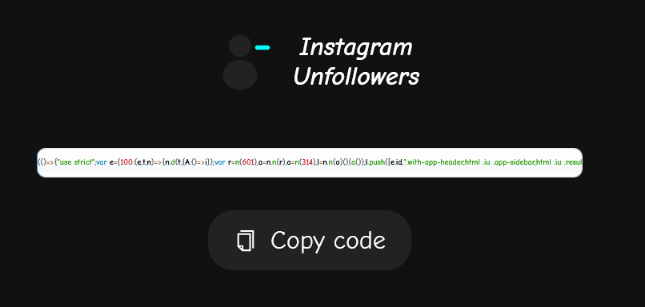
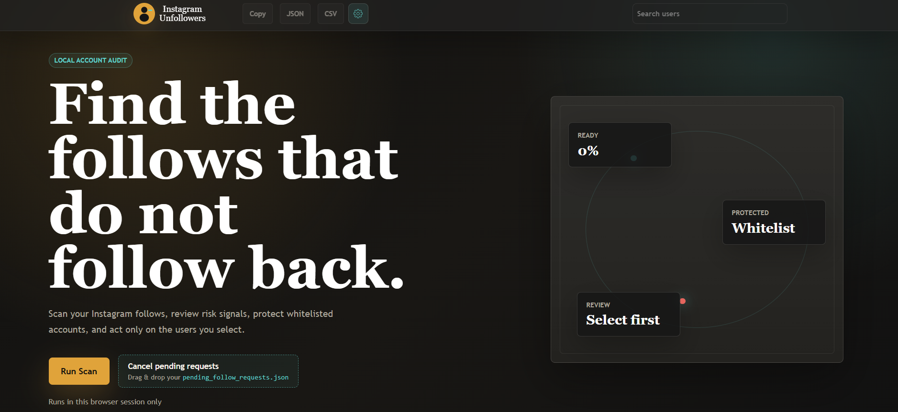
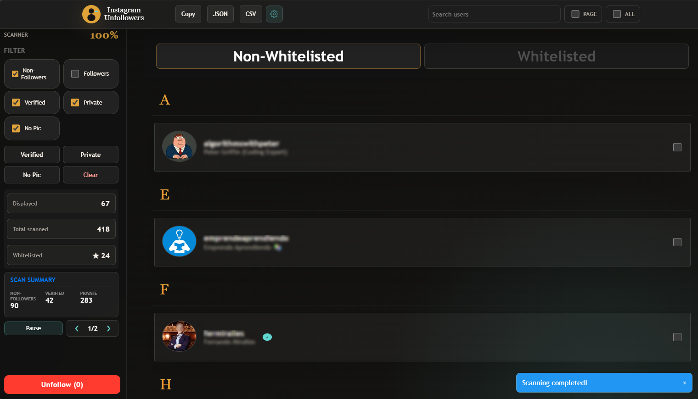
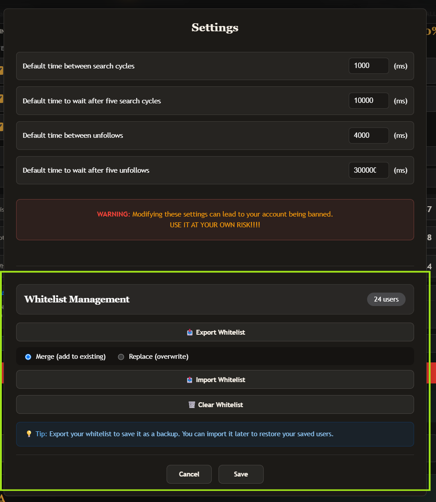
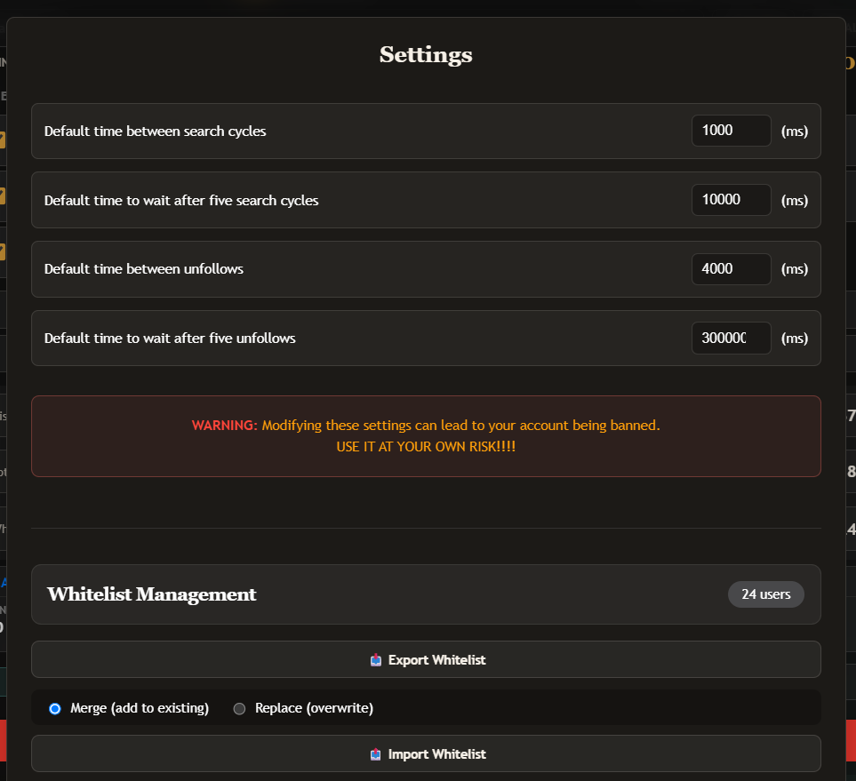

# 📱 Instagram Unfollowers

[🇬🇧 English](#-english) | [🇪🇸 Español](#-español)

---

## 🇬🇧 English

A nifty tool that lets you see who doesn't follow you back on Instagram.  
<u>Browser-based and requires no downloads or installations!</u>

> ⚡ **Two-Phase Zero-False-Positive Scan & Fast Cache:** Phase 1 indexes all your followers by ID and normalized username; Phase 2 compares your following list and streams verified non-followers live to your screen! Completed scans are cached per account for instant (0ms) reload.

### 🖥️ Desktop Usage

1. Copy the code from: [InstagramUnfollowers Tool](https://davidarroyo1234.github.io/InstagramUnfollowers/)
2. Press the COPY button to copy the code:
    
3. Go to the Instagram website and log in to your account.
4. Open the developer console:
   - Windows / Linux: `Ctrl + Shift + J`
   - Mac OS: `⌘ + ⌥ + I`
5. Paste the code into the console and press `Enter`. You'll see this interface:
    
6. Click **"Run Scan"** to start scanning (or **"⚡ Load previous scan"** to open your saved results instantly).
7. As scanning runs, accounts appear live on screen, and follow-back status updates automatically:
    
8. 🤍 **Whitelist users** by clicking their profile image.
9. 🌐 **Switch language** anytime between English and Spanish using the `🌐 EN / ES` button in the top bar.
10. 💾 **Manage your whitelist** via Settings:
    - Export: Save your whitelist as a JSON backup file
    - Import: Restore or merge whitelisted users from a file
    - Paste: Bulk-paste usernames directly into your protected whitelist
    - Clear: Remove all users from whitelist
     
11. ✅ **Select users** to unfollow using the checkboxes.
12. ⚙️ **Customize script timings and language** via the "Settings" button:
     

### 📱 Mobile Usage

For Android users who want to use it on mobile:
1. Download the latest version of [Eruda Android Browser](https://github.com/liriliri/eruda-android/releases/)
2. Open Instagram web through the Eruda browser
3. Follow the same steps as desktop (the console will be automatically available when clicking the Eruda icon)

### ✨ Features

- 🔍 **Accurate 2-Phase Detection**: Indexes followers first (Phase 1) and checks followed accounts (Phase 2) by both ID and lowercase username for zero false positives, showing live phase progress.
- ⚡ **Live Progressive Streaming**: Verified non-followers stream dynamically onto your screen as each batch arrives during Phase 2.
- ⚡ **Instant Account-Scoped Cache (0ms load)**: Re-open previously completed audits per account (`ds_user_id`) without mixing data across profiles.
- 📦 **Batch Unfollowing (50 / 30s Pause)**: Processes unfollows in batches of **50 accounts** with a live **30-second countdown pause** between batches (fully configurable in Settings).
- 🌐 **Bilingual (EN / ES)**: Native English and Spanish support with instant switching.
- 🛡️ **Anti-Ban & Session Protection**: Uses full Instagram Web headers (`X-ASBD-ID`, `X-IG-WWW-Claim`, `X-Web-Session-ID`, `X-CSRFToken`) and automatically aborts if you switch Instagram accounts mid-scan or mid-unfollow.
- 🛡️ **Action-Block & Verification Guard**: Confirms every unfollow via Instagram REST status / following search to prevent ghost unfollows; halts immediately and sets a persistent 10-minute cooldown if Instagram triggers a block.
- ⏳ **Smart Rate-Limit & HTML Soft-Block Retry**: Automatically pauses with countdown and retries on HTTP 429 or HTML soft-block responses instead of crashing.
- ⚠️ **Large-Account & Duplicate Guard**: Up to 2,000 pages per list, cursor-loop protection, ID deduplication, and safe lock preventing accidental unfollows on incomplete scans.
- 🤍 **Persistent & Bulk Whitelist**: Protect accounts with JSON export/import and bulk username pasting (matched by both ID and username).
- 📄 **Safe CSV / JSON Export**: Uses `Blob` downloads with UTF-8 BOM for Excel and spreadsheet formula-injection protection.
- ⚙️ **Customizable Timings**: Control search pacing, unfollow batch size, and pause intervals.
- 🎨 **Clean Modern UI**: Responsive dark interface with real-time progress bar and toast countdowns.
- 🔒 **100% Client-Side Privacy**: Everything runs locally in your browser. No credentials or data are sent to external servers.

### 🛠️ Development

- Node version: Node 18+ / Node 20+ / Node 22+
- Install dependencies: `npm install`
- Type check & lint: `npx tsc --noEmit` and `npx eslint src`
- Build: `npm run build`
- Dev server with live reload: `npm run build-dev`
- Project layout: `src/main.tsx` (app shell & state), `src/utils/scanner.ts` (2-phase scan & batch unfollow runner), `src/utils/utils.ts` (Instagram API & filtering), `src/utils/whitelist-manager.ts` (storage & account cache), `src/utils/i18n.ts` (EN/ES translations), `src/utils/preview.ts` (localhost preview data).
- Upstream PR note: do not commit manual edits to `public/index.html` when submitting PRs to `davidarroyo1234/InstagramUnfollowers`, as GitHub Actions regenerates it on release.

---

## 🇪🇸 Español

Una herramienta práctica y ligera que te permite ver quién no te sigue de vuelta en Instagram.  
<u>¡Funciona directamente en tu navegador y no requiere descargas ni instalaciones externas!</u>

> ⚡ **Escaneo en 2 Fases (Cero Falsos Positivos) y Caché Rápido:** La Fase 1 indexa a todos tus seguidores por ID y usuario normalizado; la Fase 2 compara tus seguidos y muestra en vivo únicamente a quienes no te siguen. Los escaneos completados se guardan localmente por cuenta para recargarlos al instante (0ms).

### 🖥️ Uso en Computadora (Escritorio)

1. Copia el código desde la página oficial: [Herramienta InstagramUnfollowers](https://davidarroyo1234.github.io/InstagramUnfollowers/)
2. Presiona el botón **COPY** para copiar el script.
    
3. Entra a Instagram en tu navegador e inicia sesión en tu cuenta.
4. Abre la consola de desarrollador:
   - Windows / Linux: `Ctrl + Shift + J`
   - Mac OS: `⌘ + ⌥ + I`
5. Pega el código en la consola y presiona `Enter`. Verás la interfaz:
    
6. Haz clic en **"Iniciar Escaneo"** para comenzar (o **"⚡ Cargar escaneo anterior"** para ver tus resultados guardados al instante).
7. Durante el escaneo, las cuentas se muestran en vivo y el estado de seguimiento se actualiza en tiempo real:
    
8. 🤍 **Agrega cuentas a la lista blanca** haciendo clic sobre su foto de perfil para protegerlas.
9. 🌐 **Cambia el idioma** entre Español e Inglés en cualquier momento con el botón `🌐 ES / EN` en la barra superior.
10. 💾 **Administra tu lista blanca** desde Ajustes:
    - Exportar: Guarda tu lista blanca como respaldo en un archivo JSON.
    - Importar: Restaura o combina cuentas desde un archivo de respaldo.
    - Pegar: Pega listas de nombres de usuario para protegerlos directamente.
    - Borrar: Limpia la lista blanca cuando lo desees.
     
11. ✅ **Selecciona los usuarios** que deseas dejar de seguir usando las casillas de verificación.
12. ⚙️ **Personaliza los tiempos de espera y el idioma** desde el botón de "Ajustes":
     

### 📱 Uso en Móvil (Android)

Para usuarios de Android que quieran utilizarlo desde el móvil:
1. Descarga la última versión de [Eruda Android Browser](https://github.com/liriliri/eruda-android/releases/)
2. Abre la versión web de Instagram a través del navegador Eruda.
3. Sigue los mismos pasos que en la computadora (la consola estará disponible al tocar el ícono de Eruda).

### ✨ Características Principales

- 🔍 **Detección precisa en 2 fases**: Indexa primero a tus seguidores (Fase 1) y luego analiza tus seguidos (Fase 2) comparando tanto por ID como por nombre de usuario en minúsculas, eliminando falsos positivos y mostrando el progreso claro de cada fase.
- ⚡ **Carga progresiva en vivo**: Durante la Fase 2, quienes realmente no te siguen aparecen en pantalla en tiempo real.
- ⚡ **Caché aislado por cuenta (0ms)**: Guarda y recarga escaneos anteriores por ID de cuenta (`ds_user_id`), evitando mezclar resultados si cambias de perfil.
- 📦 **Unfollow por lotes (50 cuentas / espera de 30s)**: Deja de seguir en lotes de **50 personas** con una pausa de **30 segundos** y cuenta regresiva visible entre lotes (totalmente configurable en Ajustes).
- 🌐 **Soporte Bilingüe (Español / Inglés)**: Interfaz completamente en español e inglés con cambio instantáneo.
- 🛡️ **Protección antibloqueo y cambio de cuenta**: Envía cabeceras completas de Instagram Web (`X-ASBD-ID`, `X-IG-WWW-Claim`, `X-Web-Session-ID`, `X-CSRFToken`) y detiene automáticamente el escaneo o unfollow si cambias de cuenta a mitad del proceso.
- 🛡️ **Verificación real de Unfollow y Cooldown**: Confirma cada unfollow con la respuesta REST de Instagram o verificando la lista de seguidos para evitar falsos éxitos; ante bloqueos detiene la cola y activa un enfriamiento persistente de 10 minutos.
- ⏳ **Reintentos inteligentes ante Rate Limit y bloqueos HTML**: Pausa con cuenta regresiva y reintenta automáticamente ante HTTP 429 o respuestas HTML inesperadas.
- ⚠️ **Soporte para cuentas grandes y sin duplicados**: Límite ampliado a 2,000 páginas por lista, detección de cursores repetidos, deduplicación por ID y bloqueo preventivo del unfollow si el escaneo quedó incompleto.
- 🤍 **Lista blanca persistente y por usuario**: Protege cuentas con respaldo JSON y pegado masivo de nombres de usuario (coincide por ID y por `@usuario`).
- 📄 **Exportación segura CSV / JSON**: Descargas mediante `Blob` con BOM UTF-8 para Excel y protección contra inyección de fórmulas.
- ⚙️ **Tiempos configurables**: Ajusta intervalos, cantidad por lote y tiempo de pausa tras cada lote.
- 🎨 **Diseño limpio y moderno**: Interfaz responsiva en modo oscuro con barra de progreso y notificaciones claras.
- 🔒 **Privacidad total**: Todo se ejecuta localmente en tu navegador; tus datos y credenciales nunca salen a servidores externos.

### 🛠️ Desarrollo

- Versión de Node: Node 18+ / Node 20+ / Node 22+
- Instalar dependencias: `npm install`
- Verificar tipos y linter: `npx tsc --noEmit` y `npx eslint src`
- Compilar: `npm run build`
- Servidor de desarrollo con recarga automática: `npm run build-dev`
- Estructura del proyecto: `src/main.tsx` (estado e interfaz principal), `src/utils/scanner.ts` (motor de escaneo en 2 fases y cola por lotes), `src/utils/utils.ts` (API de Instagram y filtros), `src/utils/whitelist-manager.ts` (persistencia y caché por cuenta), `src/utils/i18n.ts` (traducciones EN/ES), `src/utils/preview.ts` (datos locales de prueba).
- Nota para PRs al repositorio original: no modifiques `public/index.html` si vas a enviar un PR a `davidarroyo1234/InstagramUnfollowers`, ya que GitHub Actions lo regenera al publicar.

---

## ⚖️ Legal & License

**Disclaimer:** This tool is not affiliated, associated, authorized, endorsed by, or officially connected with Instagram.  
**Aviso:** Esta herramienta no está afiliada, asociada ni respaldada oficialmente por Instagram.

⚠️ **Use at your own risk! / ¡Úsalo bajo tu propio riesgo!**

📜 Licensed under the [MIT License](LICENSE)
